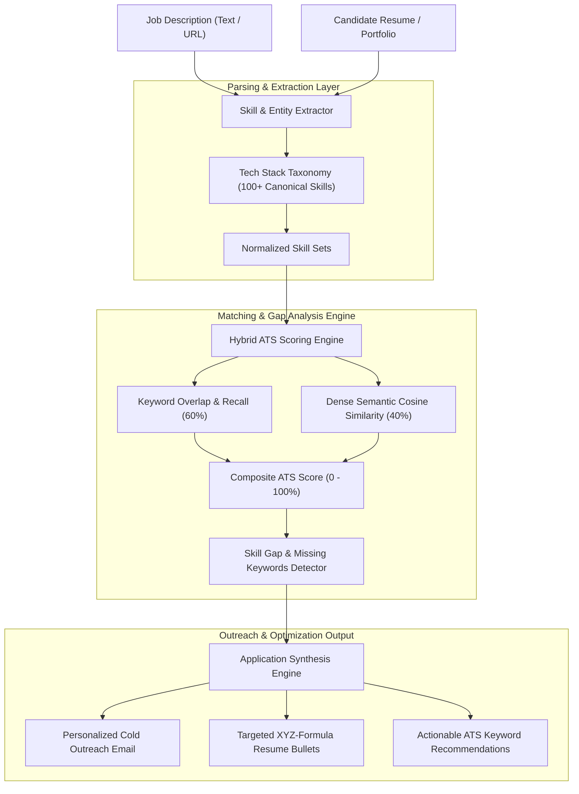

<div align="center">

# 💼 CareerPulse
### Intelligent ATS Resume Scorer, Skill Gap Analyzer & Application Tailor

[](https://github.com/Jayouss/careerpulse/actions)
[](https://www.python.org/)
[](https://fastapi.tiangolo.com/)
[](https://opensource.org/licenses/MIT)

<p align="center">
  An open-source AI platform designed to decode modern <b>Applicant Tracking Systems (ATS)</b>, calculate keyword coverage and semantic similarity, pinpoint missing skill gaps, and auto-synthesize personalized <b>cold outreach emails</b> and <b>Google XYZ-formula resume bullet points</b>.
</p>

[Architecture](#-system-architecture) • [Key Features](#-key-engineering-highlights) • [Quickstart](#-quickstart) • [CLI Tool](#-cli-usage) • [API Reference](#-api-endpoints)

</div>

---

## 🏛️ System Architecture



---

## ⚡ Key Engineering Highlights

* **Enterprise Hybrid ATS Scoring**: Emulates modern ATS systems (Greenhouse, Lever, Workday) by combining **hard keyword recall (60%)** with **dense semantic similarity (40%)** to eliminate false rejections.
* **100+ Canonical Skill Taxonomy**: Automatically detects and normalizes tech terms across languages, frameworks, AI/ML concepts, databases, DevOps tools, and architectural paradigms (e.g., `postgres` ➔ `PostgreSQL`, `k8s` ➔ `Kubernetes`, `node` ➔ `Node.js`).
* **Automated Skill Gap Identification**: Highlights exact missing technologies separating your resume from the 80%+ *Strong Match* ATS screening bracket.
* **High-Converting Cold Email Generator**: Drafts customized, concise emails directly referencing candidate GitHub repositories and matching skill proficiencies.
* **Google XYZ-Formula Resume Bullets**: Synthesizes impact-driven experience bullets: *"Accomplished [X] as measured by [Y] by doing [Z]"*.
* **Dual Interface (API & CLI)**: Use as a standalone FastAPI web service or run directly from the terminal via `cli.py`.

---

## 🚀 Quickstart

### 1. Local Installation
```bash
git clone https://github.com/Jayouss/careerpulse.git
cd careerpulse

pip install -r requirements.txt
python -m uvicorn app.main:app --host 0.0.0.0 --port 5000 --reload
```
* Server running on: `http://localhost:5000`
* Interactive Swagger Docs: `http://localhost:5000/docs`

---

### 2. Docker Setup
```bash
docker compose up --build -d
```

---

## 💻 CLI Usage

CareerPulse includes a built-in terminal CLI:

```bash
# 1. Match resume against job description
python cli.py match --job "job_spec.txt" --resume "resume.txt"

# 2. Extract tech stack from raw text
python cli.py extract --text "Looking for Python, FastAPI, Docker, and PostgreSQL"
```

---

## 🧪 Interactive Demo Simulation

Run the end-to-end integration demo showing ATS evaluation and application generation:

```bash
python scripts/demo_ats_simulation.py
```

### Sample Simulation Output:
```text
===========================================================================
>> STEP 1: SKILL EXTRACTION & CATEGORIZATION
===========================================================================
🎯 Job Extracted Skills (20):
   - Languages: Python, TypeScript
   - Backend Frameworks: FastAPI, Node.js
   - AI And ML: LLM, RAG, Vector Search, pgvector
   - Databases And Cache: PostgreSQL, Redis
   - DevOps And Cloud: CI/CD, Docker, GitHub Actions, Kubernetes

===========================================================================
>> STEP 2: ATS MATCH SCORING & GAP ANALYSIS
===========================================================================
📊 ATS Match Score: 79.9% [GOOD_MATCH]
💡 Verdict: Competitive candidate. Adding 1-2 missing keywords will dramatically boost ATS rank.

✅ Matching Skills (17): CI/CD, Docker, FastAPI, GitHub Actions, Node.js, PostgreSQL, Python, RAG, Redis, TypeScript, Vector Search, pgvector...
⚠️ Missing Core Skills (3): Caching, Event-Driven, Kubernetes

===========================================================================
>> STEP 3: PERSONALIZED COLD OUTREACH EMAIL
===========================================================================
Subject: Application: Backend & AI Engineer at Nexus Systems - Jay (CI/CD, Docker, FastAPI)

Hi Hiring Team at Nexus Systems,
I came across the Backend & AI Engineer opening at Nexus Systems...
```

---

## 📡 API Endpoints

| Method | Endpoint | Description |
| :--- | :--- | :--- |
| `POST` | `/api/v1/match` | Evaluate ATS compatibility score, matching skills, and missing gaps. |
| `POST` | `/api/v1/tailor` | Generate full dossier: ATS score, customized outreach email, and bullet points. |
| `POST` | `/api/v1/skills/extract` | Extract and categorize tech stack entities from arbitrary text. |
| `GET` | `/health` | Server health check. |

---

## 🧪 Testing

```bash
# Run pytest test suite
pytest tests -v
```

---

## 📜 License

Distributed under the MIT License. See `LICENSE` for more information.
